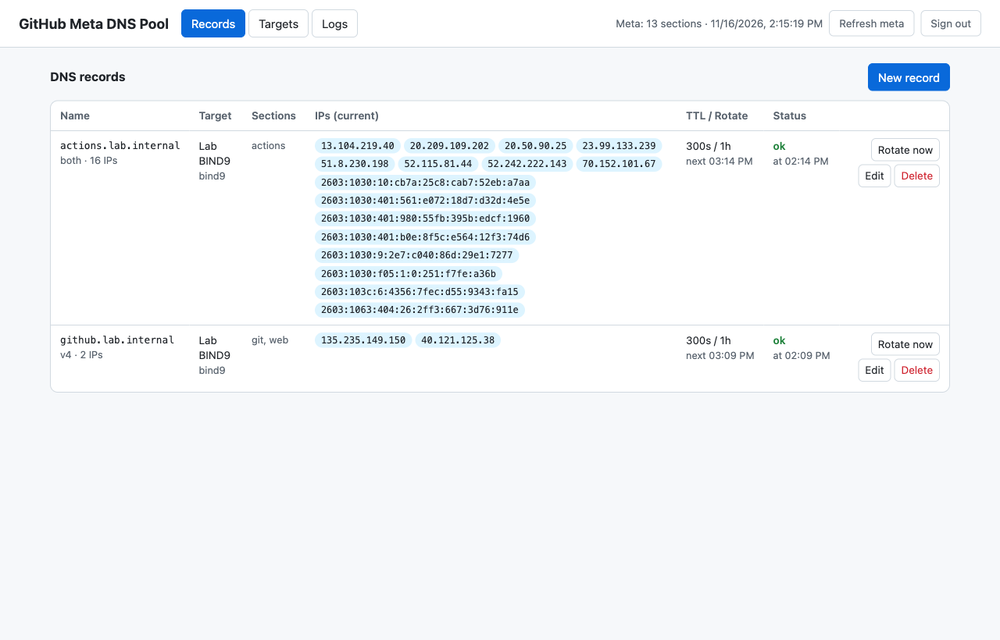
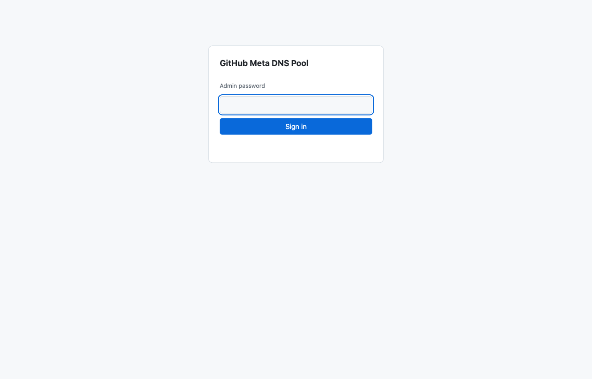
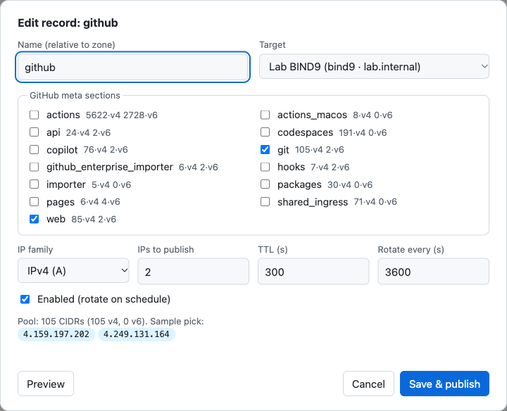
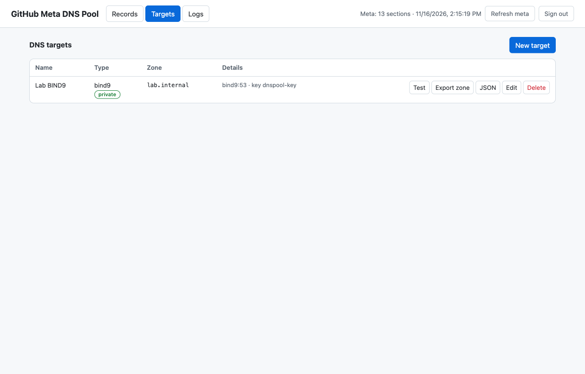
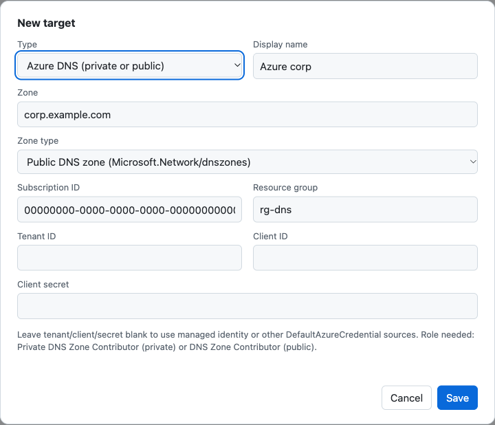
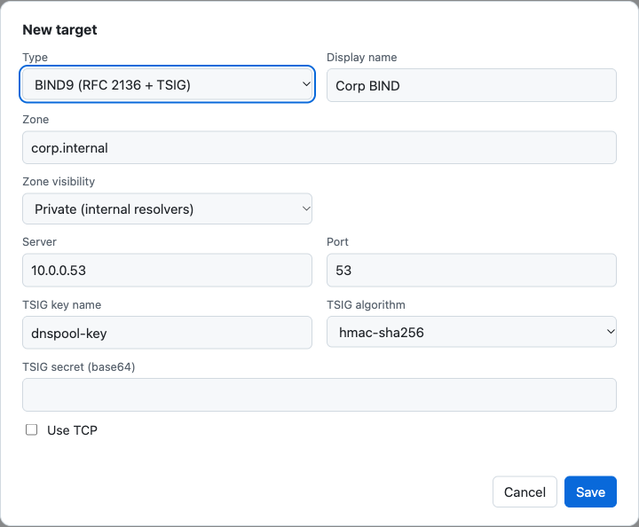
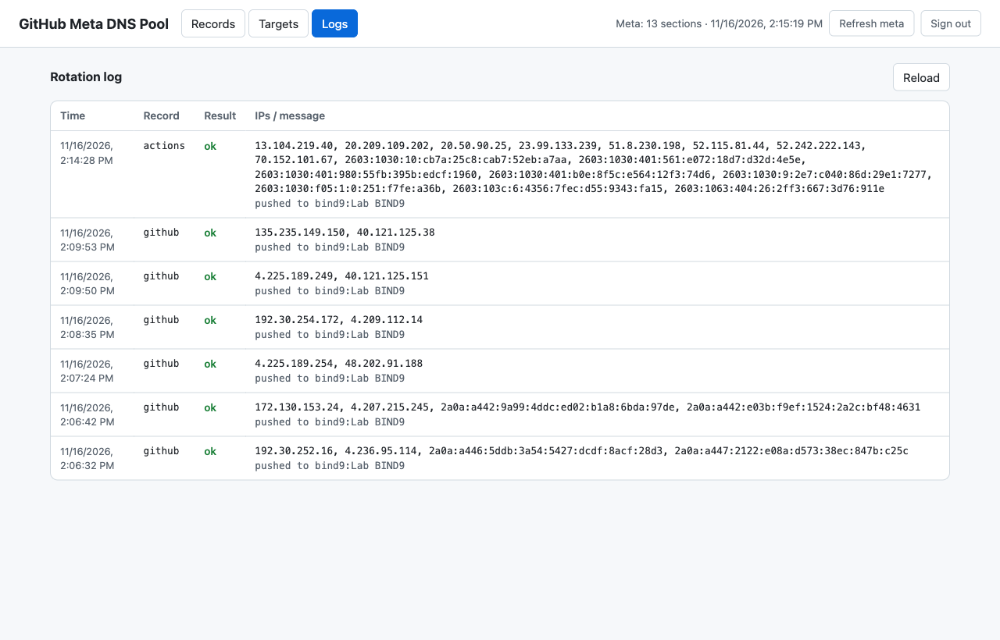
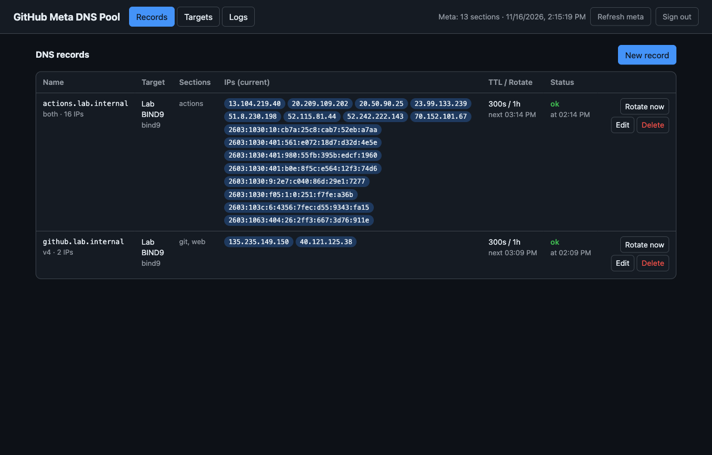
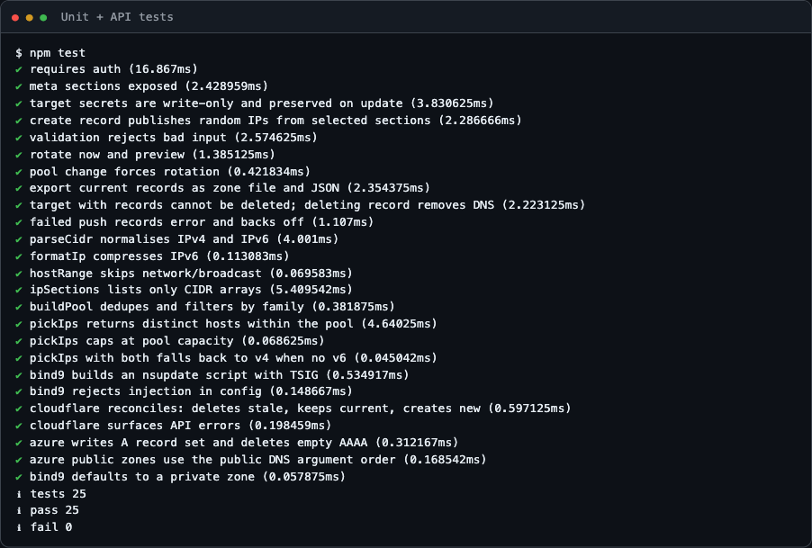
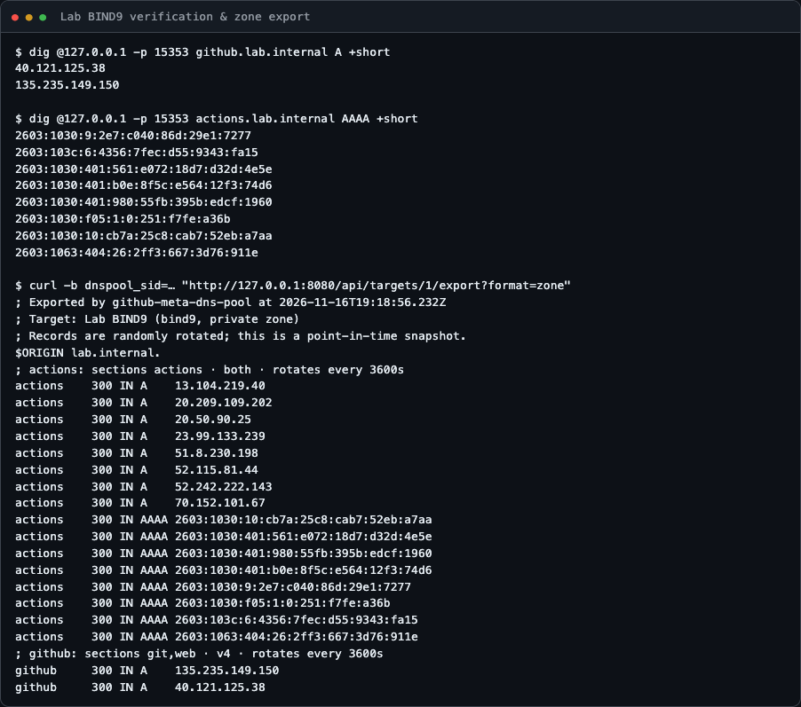

# GitHub Meta DNS Pool



Publishes a small, rotating set of GitHub IP addresses into **private or public DNS zones**. Addresses are drawn from the sections you choose in the [GitHub meta API](https://api.github.com/meta) (for example `git`, `web`, `api` or `actions`).

Instead of loading thousands of CIDRs into DNS, each record gets **N random host addresses** picked from an always-current pool. They are re-picked on a schedule, on demand, or automatically when GitHub changes the ranges.

Supported DNS targets:

| Provider | Zone visibility | Mechanism | Notes |
|---|---|---|---|
| **BIND9** | Private by default, or public | RFC 2136 dynamic update (`nsupdate`) with TSIG | Works with any RFC 2136 server. Current records can be exported as a zone file. |
| **Azure DNS** | Private or public (selectable per target) | `@azure/arm-privatedns` or `@azure/arm-dns` | Uses a service principal or managed identity / `DefaultAzureCredential` |
| **Cloudflare** | Public | API v4 DNS records (reconciled, `proxied: false`) | Publishes into the public zone once the API token and zone ID are set |

## Features

- Browser UI (vanilla JS) with login, records, targets, logs, a live pool preview and "Rotate now".
- Selectable meta sections per record. Each record can publish IPv4 (A), IPv6 (AAAA) or both.
- Random host selection inside the CIDRs, weighted by range size, with no duplicates. Network and broadcast addresses are skipped.
- Per-record IP count, TTL and rotation interval.
- The meta API is polled with ETag caching. When a record's pool changes, the record is re-rotated right away.
- Every rotation replaces the full record set, so stale addresses never accumulate.
- SQLite storage. Provider credentials are encrypted at rest with AES-256-GCM.
- Failure backoff and a rotation log.
- Each target's current records can be exported as a BIND zone file or JSON (**Targets → Export zone / JSON**).

## Screenshots

These were captured from the Docker Compose lab stack (app + `ubuntu/bind9`, zone `lab.internal`).

| | |
|---|---|
| **Sign in**<br> | **Records**: current random IPs, TTL, schedule and status<br> |
| **Record editor**: meta sections with v4/v6 CIDR counts, family, count, TTL, interval and a live pool preview<br> | **Targets**: private/public badge, Test, Export zone / JSON<br> |
| **Azure target**: private or public zone type<br> | **BIND9 target**: private by default, TSIG<br> |
| **Rotation log**<br> | **Dark mode** (follows `prefers-color-scheme`)<br> |

### Test evidence

**`npm test`**: 25 unit and API integration tests, covering the picker, providers (mocked BIND9/Cloudflare/Azure private and public), API auth, validation, rotation, backoff and export.



**Lab end-to-end check**: `dig` against the lab BIND9 returns exactly the addresses shown in the UI, and the zone export matches.



Also verified by hand in the browser: create, edit (changing the family from both to v4 removed the AAAA records), **Rotate now**, scheduled rotation at a 60s interval, arrow-key tab navigation, and that sessions and data persist across container restarts.

## Quick start (Docker)

```bash
cp .env.example .env
# set ADMIN_PASSWORD, and generate secrets:
openssl rand -base64 32   # -> APP_SECRET_KEY
openssl rand -base64 32   # -> LAB_TSIG_SECRET (only for the lab BIND9)

docker compose up -d --build              # app only
docker compose --profile lab up -d --build  # app + lab BIND9 server
```

Open http://127.0.0.1:8080 and sign in with `ADMIN_PASSWORD`. Data is stored in the `dnspool-data` volume, at `/data/dnspool.sqlite`.

### Lab BIND9

The `lab` profile runs `ubuntu/bind9` with the zone `lab.internal`, which accepts TSIG updates from `dnspool-key`. It is published at `127.0.0.1:15353`, because macOS uses port 5353 for mDNS. To use it:

1. **Targets → New target:** type BIND9, zone `lab.internal`, server `bind9`, port `53`, key name `dnspool-key`, algorithm `hmac-sha256`, and the secret from `LAB_TSIG_SECRET`. Click **Test**.
2. **Records → New record:** pick sections, family, count, TTL and interval, then click **Save & publish**.
3. Verify the record:
   ```bash
   dig @127.0.0.1 -p 15353 github.lab.internal A +short
   ```

## Running locally (without Docker)

This requires Node 20 or newer. For BIND9 targets you also need `nsupdate` (from `bind9-dnsutils` / `bind-tools`).

```bash
npm ci
ADMIN_PASSWORD=... APP_SECRET_KEY=... npm start
npm test        # node:test unit + API integration tests
```

## Configuration

| Variable | Default | Description |
|---|---|---|
| `ADMIN_PASSWORD` | **required** | UI password (8 characters minimum) |
| `APP_SECRET_KEY` | **required** | Key used to encrypt provider credentials (16 characters minimum). Changing it makes saved credentials unreadable. |
| `PORT` | `8080` | HTTP port |
| `DATA_DIR` | `./data` (`/data` in the container) | SQLite location |
| `COOKIE_SECURE` | `false` | Set to `true` when served over HTTPS |
| `TRUST_PROXY` | `false` | Set to `true` behind a reverse proxy, so login rate limiting sees client IPs |
| `SESSION_TTL_SEC` | `43200` | Session lifetime |
| `META_URL` | `https://api.github.com/meta` | Meta source |
| `META_REFRESH_SEC` | `3600` | How often to poll meta. Unauthenticated requests are limited to 60 per hour. |
| `GITHUB_TOKEN` | — | Optional token that raises the meta API rate limit |
| `SCHEDULER_TICK_SEC` | `15` | How often due records are checked |
| `MAX_IPS_PER_RECORD` | `16` | Upper bound on IPs per record |
| `MIN_TTL` / `MIN_INTERVAL_SEC` | `60` / `60` | Lower bounds for TTL and rotation interval |
| `LAB_TSIG_SECRET` | — | TSIG secret for the lab BIND9 container |

## Provider setup

### BIND9

BIND9 targets are treated as **private** zones by default (internal resolvers or split-horizon views). Set **Zone visibility** to *public* if the server is authoritative on the internet; this setting is a label shown in the UI and in exports and does not change how updates are sent.

Create a TSIG key and allow it to update only the record types the app needs:

```
key "dnspool-key" { algorithm hmac-sha256; secret "<base64>"; };

zone "corp.internal" {
  type primary;
  file "/var/lib/bind/db.corp.internal";
  update-policy { grant dnspool-key subdomain corp.internal. A AAAA TXT; };
};
```

`TXT` is only used by the **Test** button. It writes and then removes `_dnspool-test.<zone>`. Enable **Use TCP** if UDP updates are blocked.

### Azure DNS (private or public)

- **Zone type** selects the zone kind: *Private DNS zone* (`Microsoft.Network/privateDnsZones`, the default) or *Public DNS zone* (`Microsoft.Network/dnszones`).
- Fields: subscription ID, resource group and the zone name. For a service principal, also add the tenant ID, client ID and client secret.
- If you leave the service-principal fields empty, the app uses `DefaultAzureCredential`. This covers managed identity, workload identity and `AZURE_*` environment variables.
- The identity needs the **Private DNS Zone Contributor** role (private zones) or the **DNS Zone Contributor** role (public zones) on the zone or resource group.

### Cloudflare

- Fields: an API token with **Zone → DNS → Edit** on the zone, and the 32-character zone ID.
- Records are created with `proxied: false`.
- Cloudflare zones are public: once the token and zone ID are set, records are resolvable on the internet. Cloudflare has no private zone type.

## Exporting records

Each target row on the **Targets** tab has **Export zone** and **JSON** links. These download a point-in-time snapshot of the addresses currently published for every record on that target. This is useful for loading into another BIND server, reviewing changes or keeping backups.

- `GET /api/targets/:id/export` (or `?format=zone`): a BIND zone-file fragment with `$ORIGIN`, one `A`/`AAAA` line per address, and comments for the sections and rotation interval.
- `GET /api/targets/:id/export?format=json`: target details, visibility, and each record's FQDN, TTL, sections and current A/AAAA addresses.

Both endpoints require a signed-in session. Exports reflect the most recent rotation, so they change whenever records rotate.

## How rotation works

1. The meta API is fetched and cached with ETag. IP sections are detected automatically (any key containing only CIDRs).
2. A record's pool is the de-duplicated set of CIDRs from its selected sections, filtered by IP family.
3. On each rotation, `count` distinct host addresses are picked at random. Each CIDR is weighted by its size. With family "both", the split is roughly half IPv4 and half IPv6.
4. The provider replaces the record's entire A/AAAA set with the new addresses, using the configured TTL.
5. The next rotation is due after `interval`. If a push fails, it is retried with exponential backoff (30s, 60s, … capped at the interval).
6. When meta changes, any record whose pool hash changed is rotated on the next tick.

Notes on record changes:

- Disabling a record stops rotation but leaves the current DNS entries in place.
- Deleting a record removes it from DNS. Through the API, `DELETE /api/records/:id?keepDns=true` keeps the DNS entry.
- Renaming a record, or moving it to another target, removes the old entry.

## Security notes

- Provider secrets are encrypted in SQLite and never returned by the API. Leaving a secret blank on edit keeps the stored value.
- Session cookies are HttpOnly and SameSite=Strict. Login is locked out for 5 minutes after 5 failures per IP.
- The UI uses a strict CSP: no inline scripts or styles.
- BIND9 inputs are validated before they are written to the `nsupdate` script.
- The app is bound to `127.0.0.1` by default. Put a TLS reverse proxy in front of it, and set `COOKIE_SECURE=true` and `TRUST_PROXY=true`, before exposing it.

## Project layout

```
src/            Express API, rotator, picker, SQLite repo, providers/
public/         Browser UI (index.html, app.js, styles.css)
test/           node:test suites
docker/bind9/   Lab BIND9 config
docs/screenshots/  UI and test screenshots
```
